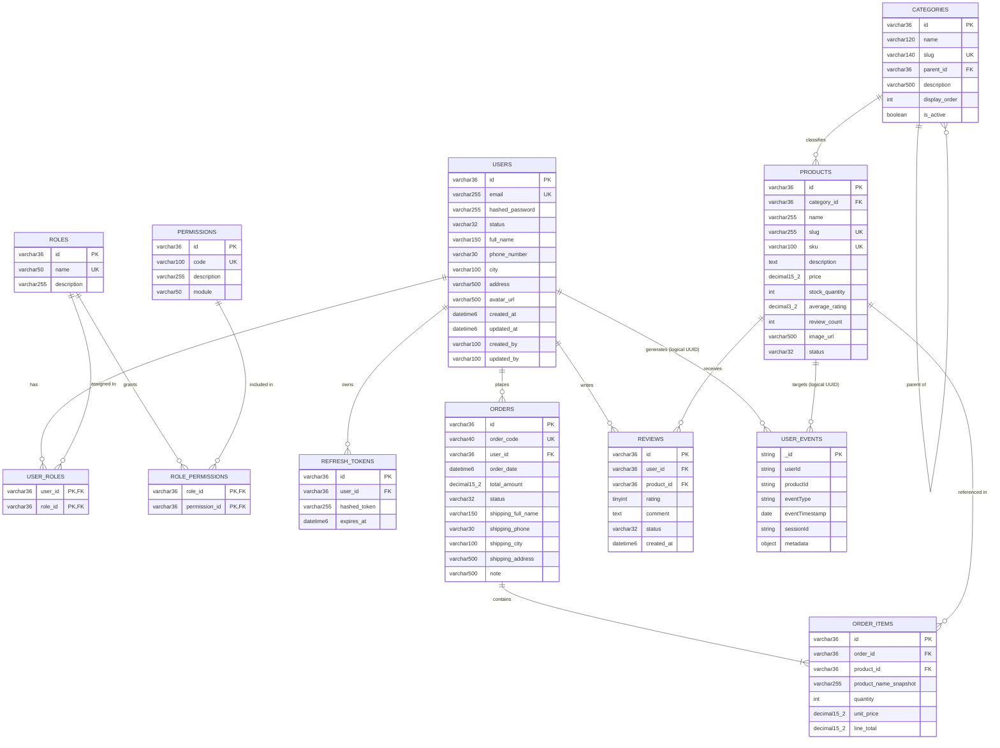

# Master Database Schema Blueprint (`shopflow-backend`)

> Tài liệu thiết kế cơ sở dữ liệu chuẩn hóa cho toàn bộ hệ thống E-Commerce **`shopflow-backend`**, ánh xạ trực tiếp từ **6 bảng dataset mẫu CSV** (`users.csv`, `products.csv`, `orders.csv`, `order_items.csv`, `reviews.csv`, `events.csv`) và tuân thủ **Clean Architecture + DDD + CQRS** cùng `AGENTS.md`.
>
> **Phạm vi triển khai hiện tại:** Module `auth` (`users` đã mở rộng hồ sơ, `roles`, `permissions`, `user_roles`, `role_permissions`, `refresh_tokens`) đã có code & chạy trên MySQL. Các bảng `categories`, `products`, `orders`, `order_items`, `reviews` và collection `user_events` dưới đây là **Master Blueprint** cho các pha mở rộng tiếp theo (chưa tạo JPA/Mongo entities trong pha hiện tại).

---

## 1. Quy Ước Thiết Kế Dữ Liệu Cốt Lõi

1. **Khóa chính UUID (`VARCHAR(36)`):**
   - Toàn bộ bảng nghiệp vụ MySQL sử dụng khóa chính `id VARCHAR(36) NOT NULL PRIMARY KEY` nhằm tương thích ổn định với MySQL `8.x`, JPA `BaseJpaEntity` (`Persistable<String>`) và domain `@JvmInline value class *Id(val value: UUID)`.
   - Khi import dữ liệu từ bộ CSV mẫu (vốn dùng ID số nguyên hoặc chuỗi ngắn như `user_id`, `product_id`, `order_id`), áp dụng **Deterministic UUID (`UUID.nameUUIDFromBytes`)** theo công thức `"shopflow:<entity>:<csv_id>"` để đảm bảo tính lũy đẳng (*idempotent re-import*) và toàn vẹn khóa ngoại xuyên suốt 6 file.
2. **Kế thừa Audit Columns từ `BaseJpaEntity`:**
   - Mọi MySQL Entity (trừ bảng nối N-N `user_roles`, `role_permissions`) bắt buộc kế thừa `BaseJpaEntity`, cung cấp sẵn 5 cột chuẩn:
     - `id VARCHAR(36) NOT NULL PRIMARY KEY`
     - `created_at DATETIME(6) NOT NULL` (`updatable = false`)
     - `updated_at DATETIME(6) NOT NULL`
     - `created_by VARCHAR(100) NULL` (`updatable = false`, mặc định `"SYSTEM"` khi tự đăng ký / seed / batch import)
     - `updated_by VARCHAR(100) NULL` (ghi nhận `userId` từ JWT khi user hoặc admin thao tác)
3. **Độ Chính Xác Tiền Tệ (`Money` / `BigDecimal`):**
   - Mọi cột giá tiền & tổng tiền trên MySQL (`products.price`, `orders.total_amount`, `order_items.unit_price`, `order_items.line_total`) **bắt buộc dùng `DECIMAL(15, 2)`**, ánh xạ sang `java.math.BigDecimal` ở tầng Infrastructure/Application và Value Object `Money` ở tầng Domain. Tuyệt đối **không** dùng `FLOAT` hoặc `DOUBLE`.
4. **Chiến Lược Lưu Trữ Đa Mô Hình (Polyglot Persistence):**
   - **MySQL 8 (`shopflow_db` — ACID):** `auth` & `user` (`users`, `roles`, `permissions`, `user_roles`, `role_permissions`, `refresh_tokens`), `product` (`categories`, `products`), `order` (`orders`, `order_items`), `review` (`reviews`).
   - **MongoDB (`shopflow` — High-Throughput Telemetry):** Collection `user_events` cho `events.csv` (xem sản phẩm, thêm giỏ, wishlist, mua hàng).
   - **Redis (Dành cho mở rộng tốc độ cao):** Giỏ hàng tạm (`cart`), khóa giữ tồn kho Flash-sale (`inventory`), cache giá/khuyến mãi (`promotion`).

---

## 2. Ánh Xạ Bộ Dataset Mẫu 6 File CSV -> Hệ Thống CSDL

| Dataset CSV | Cột gốc trong CSV | Đích lưu trữ (`Store` -> `Table / Collection`) | Ánh xạ cột chuẩn hóa & Ghi chú thiết kế | Trạng thái |
|---|---|---|---|---|
| `users.csv` | `user_id`, `name`, `email`, `city` | **MySQL** -> `users` (+ `user_roles`) | `user_id` -> `id` (UUID); `name` -> `full_name`; `email` -> `email` (`UNIQUE`); `city` -> `city`; bổ sung `phone_number`, `address`, `avatar_url`, `hashed_password`, `status` + audit & RBAC (`ROLE_CUSTOMER`). | **Đã triển khai** |
| `products.csv` | `product_id`, `product_name`, `category`, `price`, `rating` | **MySQL** -> `categories`, `products` | `category` chuẩn hóa thành bảng `categories` (`id`, `name`, `slug`); `product_id` -> `products.id`; `product_name` -> `products.name`; `price` -> `DECIMAL(15, 2)`; `rating` -> `average_rating DECIMAL(3, 2)`. | Blueprint |
| `orders.csv` | `order_id`, `user_id`, `order_date`, `total_amount`, `status` | **MySQL** -> `orders` | `order_id` -> `id`; `user_id` -> `user_id` (`FK -> users.id`); `order_date` -> `order_date DATETIME(6)`; `total_amount` -> `DECIMAL(15, 2)`; `status` -> enum lifecycle + thông tin giao hàng snapshot. | Blueprint |
| `order_items.csv` | `order_item_id`, `order_id`, `product_id`, `quantity`, `unit_price` | **MySQL** -> `order_items` | `order_item_id` -> `id`; `order_id` -> `order_id` (`FK -> orders.id`); `product_id` -> `product_id` (`FK -> products.id`); `quantity` -> `INT`; `unit_price` -> `DECIMAL(15, 2)` + `line_total DECIMAL(15, 2)`. | Blueprint |
| `reviews.csv` | `review_id`, `user_id`, `product_id`, `rating`, `comment`, timestamps | **MySQL** -> `reviews` | `review_id` -> `id`; `user_id` -> `FK -> users.id`; `product_id` -> `FK -> products.id`; `rating` -> `TINYINT` (`1..5`); `comment` -> `TEXT`; timestamps từ `BaseJpaEntity`. | Blueprint |
| `events.csv` | `event_id`, `user_id`, `event_type`, `product_id`, `event_timestamp` | **MongoDB** -> `user_events` | Document tối ưu ghi nhanh (high-volume append-only): `_id`, `userId`, `productId`, `eventType`, `eventTimestamp`, `sessionId`, `metadata`. | Blueprint |

---

## 3. Sơ Đồ Quan Hệ Thực Thể Tổng Thể (ER Diagram)



---

## 4. Đặc Tả Schema MySQL 8 (`shopflow_db`)

### 4.1. Bounded Context `auth` / `user` *(Đã triển khai thực tế)*

#### Bảng `users` (tương ứng `users.csv`)
| Cột SQL | Kiểu dữ liệu | Ràng buộc & Index | Mô tả / Ánh xạ |
|---|---|---|---|
| `id` | `VARCHAR(36)` | `PRIMARY KEY, NOT NULL` | UUID người dùng (`user_id` trong `users.csv`) |
| `email` | `VARCHAR(255)` | `NOT NULL, UNIQUE (idx_users_email)` | Email đăng nhập đã chuẩn hóa lowercase |
| `hashed_password` | `VARCHAR(255)` | `NOT NULL` | Mật khẩu băm BCrypt |
| `status` | `VARCHAR(32) / ENUM` | `NOT NULL` | Trạng thái tài khoản (`ACTIVE`, `INACTIVE`, `BANNED` từ `UserStatus`) |
| `full_name` | `VARCHAR(150)` | `NULL` | Họ tên đầy đủ (`name` trong `users.csv`) |
| `phone_number` | `VARCHAR(30)` | `NULL` | Số điện thoại liên hệ & giao hàng |
| `city` | `VARCHAR(100)` | `NULL, INDEX (idx_users_city)` | Tỉnh/thành phố (`city` trong `users.csv`) |
| `address` | `VARCHAR(500)` | `NULL` | Địa chỉ giao hàng mặc định |
| `avatar_url` | `VARCHAR(500)` | `NULL` | URL ảnh đại diện |
| `created_at`, `updated_at`, `created_by`, `updated_by` | `DATETIME(6)` / `VARCHAR(100)` | Từ `BaseJpaEntity` | Thời gian & định danh người tạo/sửa |

#### Các bảng RBAC & Token (`roles`, `permissions`, `user_roles`, `role_permissions`, `refresh_tokens`)
- **`roles`**: `id VARCHAR(36) PK`, `name VARCHAR(50) NOT NULL UNIQUE (idx_roles_name)`, `description VARCHAR(255) NOT NULL` + audit `BaseJpaEntity`.
- **`permissions`**: `id VARCHAR(36) PK`, `code VARCHAR(100) NOT NULL UNIQUE (idx_permissions_code)`, `description VARCHAR(255) NOT NULL`, `module VARCHAR(50) NOT NULL INDEX (idx_permissions_module)` + audit `BaseJpaEntity`.
- **`user_roles`**: `user_id VARCHAR(36) FK -> users.id`, `role_id VARCHAR(36) FK -> roles.id` (composite PK `(user_id, role_id)`).
- **`role_permissions`**: `role_id VARCHAR(36) FK -> roles.id`, `permission_id VARCHAR(36) FK -> permissions.id` (composite PK `(role_id, permission_id)`).
- **`refresh_tokens`**: `id VARCHAR(36) PK`, `user_id VARCHAR(36) NOT NULL`, `hashed_token VARCHAR(255) NOT NULL`, `expires_at DATETIME(6) NOT NULL` + `UNIQUE idx_refresh_tokens_user_hash (user_id, hashed_token)`, `INDEX idx_refresh_tokens_expires_at (expires_at)` + audit `BaseJpaEntity`.

---

### 4.2. Bounded Context `product` *(Master Blueprint — Chưa tạo code)*

#### Bảng `categories`
```sql
CREATE TABLE categories (
    id            VARCHAR(36)  NOT NULL PRIMARY KEY,
    name          VARCHAR(120) NOT NULL,
    slug          VARCHAR(140) NOT NULL,
    parent_id     VARCHAR(36)  NULL,
    description   VARCHAR(500) NULL,
    display_order INT          NOT NULL DEFAULT 0,
    is_active     BOOLEAN      NOT NULL DEFAULT TRUE,
    created_at    DATETIME(6)  NOT NULL,
    updated_at    DATETIME(6)  NOT NULL,
    created_by    VARCHAR(100) NULL,
    updated_by    VARCHAR(100) NULL,
    CONSTRAINT uk_categories_slug UNIQUE (slug),
    CONSTRAINT fk_categories_parent FOREIGN KEY (parent_id) REFERENCES categories (id),
    INDEX idx_categories_parent_order (parent_id, display_order)
);
```

#### Bảng `products` (tương ứng `products.csv`)
```sql
CREATE TABLE products (
    id             VARCHAR(36)    NOT NULL PRIMARY KEY,
    category_id    VARCHAR(36)    NOT NULL,
    name           VARCHAR(255)   NOT NULL,
    slug           VARCHAR(255)   NOT NULL,
    sku            VARCHAR(100)   NOT NULL,
    description    TEXT           NULL,
    price          DECIMAL(15, 2) NOT NULL,
    stock_quantity INT            NOT NULL DEFAULT 0,
    average_rating DECIMAL(3, 2)  NOT NULL DEFAULT 0.00,
    review_count   INT            NOT NULL DEFAULT 0,
    image_url      VARCHAR(500)   NULL,
    status         VARCHAR(32)    NOT NULL DEFAULT 'ACTIVE',
    created_at     DATETIME(6)    NOT NULL,
    updated_at     DATETIME(6)    NOT NULL,
    created_by     VARCHAR(100)   NULL,
    updated_by     VARCHAR(100)   NULL,
    CONSTRAINT uk_products_slug UNIQUE (slug),
    CONSTRAINT uk_products_sku  UNIQUE (sku),
    CONSTRAINT fk_products_category FOREIGN KEY (category_id) REFERENCES categories (id),
    CONSTRAINT chk_products_price   CHECK (price >= 0),
    CONSTRAINT chk_products_stock   CHECK (stock_quantity >= 0),
    CONSTRAINT chk_products_rating  CHECK (average_rating BETWEEN 0.00 AND 5.00),
    INDEX idx_products_category_status (category_id, status),
    INDEX idx_products_price (price),
    INDEX idx_products_rating (average_rating)
);
```
> **Ghi chú Domain:** Khi import `products.csv` (`product_id`, `product_name`, `category`, `price`, `rating`), giá trị cột `category` được upsert trước vào `categories` (tạo slug chuẩn hóa), sau đó gán `category_id` cho `products`; `rating` khởi tạo vào `average_rating` trước khi có bản ghi `reviews` phát sinh thêm.

---

### 4.3. Bounded Context `order` *(Master Blueprint — Chưa tạo code)*

#### Bảng `orders` (tương ứng `orders.csv`)
```sql
CREATE TABLE orders (
    id                 VARCHAR(36)    NOT NULL PRIMARY KEY,
    order_code         VARCHAR(40)    NOT NULL,
    user_id            VARCHAR(36)    NOT NULL,
    order_date         DATETIME(6)    NOT NULL,
    total_amount       DECIMAL(15, 2) NOT NULL,
    status             VARCHAR(32)    NOT NULL DEFAULT 'PENDING',
    shipping_full_name VARCHAR(150)   NULL,
    shipping_phone     VARCHAR(30)    NULL,
    shipping_city      VARCHAR(100)   NULL,
    shipping_address   VARCHAR(500)   NULL,
    note               VARCHAR(500)   NULL,
    created_at         DATETIME(6)    NOT NULL,
    updated_at         DATETIME(6)    NOT NULL,
    created_by         VARCHAR(100)   NULL,
    updated_by         VARCHAR(100)   NULL,
    CONSTRAINT uk_orders_order_code UNIQUE (order_code),
    CONSTRAINT fk_orders_user FOREIGN KEY (user_id) REFERENCES users (id),
    CONSTRAINT chk_orders_total_amount CHECK (total_amount >= 0),
    INDEX idx_orders_user_date (user_id, order_date DESC),
    INDEX idx_orders_status_date (status, order_date DESC)
);
```
- **Vòng đời `status` chuẩn hóa:** `PENDING` -> `CONFIRMED` -> `PAID` -> `SHIPPING` -> `DELIVERED` / `CANCELLED` / `REFUNDED`.

#### Bảng `order_items` (tương ứng `order_items.csv`)
```sql
CREATE TABLE order_items (
    id                    VARCHAR(36)    NOT NULL PRIMARY KEY,
    order_id              VARCHAR(36)    NOT NULL,
    product_id            VARCHAR(36)    NOT NULL,
    product_name_snapshot VARCHAR(255)   NOT NULL,
    quantity              INT            NOT NULL,
    unit_price            DECIMAL(15, 2) NOT NULL,
    line_total            DECIMAL(15, 2) NOT NULL,
    created_at            DATETIME(6)    NOT NULL,
    updated_at            DATETIME(6)    NOT NULL,
    created_by            VARCHAR(100)   NULL,
    updated_by            VARCHAR(100)   NULL,
    CONSTRAINT fk_order_items_order   FOREIGN KEY (order_id)   REFERENCES orders (id),
    CONSTRAINT fk_order_items_product FOREIGN KEY (product_id) REFERENCES products (id),
    CONSTRAINT chk_order_items_qty    CHECK (quantity > 0),
    CONSTRAINT chk_order_items_price  CHECK (unit_price >= 0 AND line_total >= 0),
    INDEX idx_order_items_order   (order_id),
    INDEX idx_order_items_product (product_id)
);
```
> **Ghi chú Domain:** Lưu `product_name_snapshot` và `unit_price` tại thời điểm đặt hàng giúp hóa đơn lịch sử bất biến ngay cả khi giá hoặc tên sản phẩm trong `products` thay đổi về sau.

---

### 4.4. Bounded Context `review` / `product` *(Master Blueprint — Chưa tạo code)*

#### Bảng `reviews` (tương ứng `reviews.csv`)
```sql
CREATE TABLE reviews (
    id         VARCHAR(36)  NOT NULL PRIMARY KEY,
    user_id    VARCHAR(36)  NOT NULL,
    product_id VARCHAR(36)  NOT NULL,
    rating     TINYINT      NOT NULL,
    comment    TEXT         NULL,
    status     VARCHAR(32)  NOT NULL DEFAULT 'PUBLISHED',
    created_at DATETIME(6)  NOT NULL,
    updated_at DATETIME(6)  NOT NULL,
    created_by VARCHAR(100) NULL,
    updated_by VARCHAR(100) NULL,
    CONSTRAINT fk_reviews_user    FOREIGN KEY (user_id)    REFERENCES users (id),
    CONSTRAINT fk_reviews_product FOREIGN KEY (product_id) REFERENCES products (id),
    CONSTRAINT chk_reviews_rating CHECK (rating BETWEEN 1 AND 5),
    INDEX idx_reviews_product_created (product_id, created_at DESC),
    INDEX idx_reviews_user_product (user_id, product_id)
);
```
> **Lưu ý Ràng buộc Nghiệp vụ:** Trong production API có thể bật quy tắc mỗi khách hàng chỉ đánh giá 1 lần trên mỗi đơn/sản phẩm (`UNIQUE(user_id, product_id)`), nhưng ở thiết kế tổng quát ưu tiên non-unique composite index `idx_reviews_user_product` để tương thích dữ liệu tổng hợp từ `reviews.csv` (trong trường hợp một `user_id` trong dataset có nhiều đánh giá cho cùng `product_id`). Khi có review mới được duyệt (`PUBLISHED`), cập nhật lại `products.average_rating` và `products.review_count` bất đồng bộ qua `DomainEvent` hoặc trong transaction CQRS.

---

## 5. Đặc Tả Schema MongoDB (`shopflow`) — Bounded Context `analytics`

### Collection `user_events` (tương ứng `events.csv`)

Hành vi người dùng phát sinh lưu lượng ghi cực lớn và mang tính thời chuỗi/append-only nên lưu trong **MongoDB** (`spring.mongodb.uri` + `spring.data.mongodb.auto-index-creation=true`) thay vì gây áp lực khóa bảng lên MySQL giao dịch.

#### Cấu trúc Document JSON mẫu
```json
{
  "_id": "7f3c8d40-9a12-4b65-a101-e5a8c9012345",
  "userId": "3d81bf10-12a4-4f22-9110-112233445566",
  "productId": "8c10a771-44e2-4f99-81a0-778899aabbcc",
  "eventType": "CART_ADD",
  "eventTimestamp": "2026-11-15T08:30:00Z",
  "sessionId": "sess_01JXYZ",
  "metadata": {
    "source": "search_page",
    "citySnapshot": "Ho Chi Minh",
    "device": "web"
  },
  "createdAt": "2026-11-15T08:30:00.120Z"
}
```

#### Quy ước trường & Chỉ mục (`Indexes`)
- **`eventType` Enum:** `PRODUCT_VIEW`, `CART_ADD`, `WISHLIST_ADD`, `PURCHASE`.
- **Compound Indexes đề xuất:**
  1. `{ "userId": 1, "eventTimestamp": -1 }` — Truy vấn lịch sử hành vi gần nhất của user / gợi ý sản phẩm cá nhân hóa.
  2. `{ "productId": 1, "eventType": 1, "eventTimestamp": -1 }` — Đếm lượt xem, tỷ lệ thêm giỏ hàng / chuyển đổi mua hàng theo sản phẩm & khung thời gian.
  3. `{ "eventType": 1, "eventTimestamp": -1 }` — Thống kê funnel toàn hệ thống theo ngày/tuần.
  4. *(Tùy chọn)* TTL Index trên `createdAt` nếu muốn tự động lưu trữ/dọn log quá 365 ngày.
- **Biến thể MySQL Reporting (tùy chọn):** Nếu cần chạy SQL BI JOIN trực tiếp không qua ETL, có thể đồng bộ bảng tổng hợp theo ngày (`daily_product_metrics`) về MySQL thay vì đổ toàn bộ raw events vào MySQL.

---

## 6. Checklist Khi Triển Khai Các Module Mới Từ Blueprint Này

Khi bắt đầu phát triển từng module (`product`, `order`, `review`, `analytics`), bắt buộc thực hiện theo [`docs/workflows/new-feature-workflow.md`](../workflows/new-feature-workflow.md):
1. Đặt Value Object (`Money`, `ProductId`, `OrderId`, `ReviewId`, `Rating`) và Aggregate Root hoàn toàn **Pure Kotlin** trong `domain/model/<context>/`.
2. Entity MySQL đặt tại `infrastructure/persistence/entity/<context>/*JpaEntity.kt`, sử dụng `class` thường (không dùng `data class`), kế thừa `BaseJpaEntity`, map `DECIMAL(15, 2)` sang `BigDecimal`.
3. Tạo `*PersistenceMapper` + CQRS `*QueryService` riêng biệt và kiểm chứng cuối cùng bằng `.\gradlew.bat check --console=plain`.
